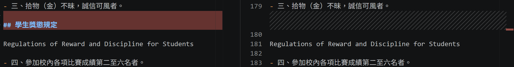
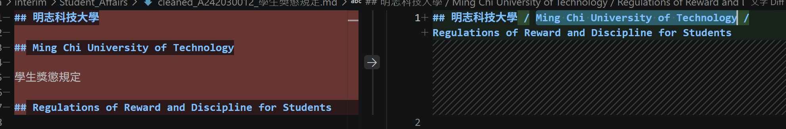
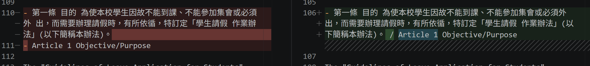
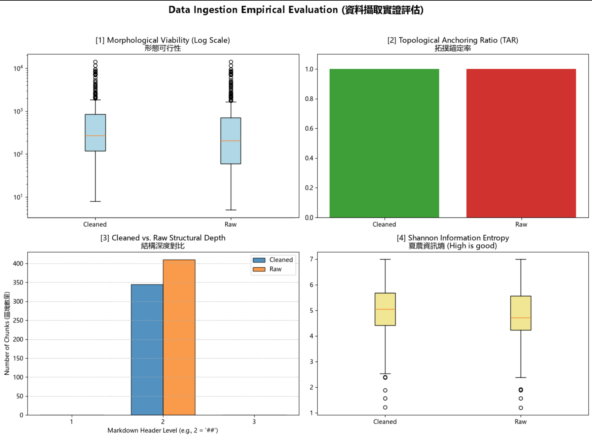

# 資料前處理報告 (Data Preparation Report)

> 期中評量 · NLP 自然語言處理 115-S1
> 填寫方式：請把所有「（ ）」與 `___` 替換成你自己的內容，並刪除 `>` 開頭的說明文字。

- **學號 / 姓名**：_U12627008呂承洋
- **專案名稱**：U12617008
- **完成的任務**：- [ ] 1-A 頁首頁尾清除　- [ ] 1-B 雙語標題合併　- [ ] 1-C 雙語條文合併

---

## 1. 資料集概覽 (Dataset Overview)

> 數字來源：`01_Data_Ingestion.ipynb` 第 2 節 (掃描 PDF) 與第 5 節 (批次處理) 的輸出。

| 類別 (Cluster) | PDF 數量 | 清洗前 chunk 數 | 清洗後 chunk 數 |
|---|---|---|---|
| Academic_Affairs |3 |96 | 65|
|Library_Information | 3| 248|225 |
|Student_Affairs |3 |66 |55 |
| **合計** | 9|410 |345|

**問題 (2–3 句)：**  9 份 PDF清洗前和清洗後都是 410 個 chunk，數量沒有改變。主要是因為這次清洗的目的是把頁首、頁尾這些不需要的文字去掉，讓資料看起來比較乾淨，而不是要減少文字區塊的數量。雖然合併中英文標題和條文可能會影響文字的切分，但從這次的結果來看，chunk 的數量還是一樣，沒有明顯的改變

> 提示：chunk 是用什麼規則切開的？請看 notebook 第 5 節的 `chunking_regex`。

___

## 2. 清洗步驟 (Cleaning Steps)

> **截圖來源：** `data/interim/<類別>/` 中的 `raw_*.md` (清洗前) 與 `cleaned_*.md` (清洗後)，也就是批次處理存下的**真實檔案**。
>
> **[重要] 不可使用 notebook 中的範例。** notebook 任務 1-A、1-B、1-C 的測試文字 (第二十一條、明志科技大學 / Ming Chi University of Technology、第十五條 / Article 15) **不能**作為你的截圖。請在真實檔案中**另找一處**，可以是其他 PDF 的檔案。使用範例的截圖**不給分**。
>
> **截圖方法 (VS Code 比較檢視)：**
> 1. 在檔案總管對 `raw_<檔名>.md` 按右鍵 → **Select for Compare**。
> 2. 對同一份文件的 `cleaned_<檔名>.md` 按右鍵 → **Compare with Selected**。
> 3. 左右並排顯示，紅色 = 刪除，綠色 = 新增或修改。按 `Ctrl + F` 搜尋，找到該任務造成的變更。
> 4. 每個任務截**一張**圖，存到 `reports/figures/`，**檔名必須完全相同** (否則圖片不會顯示)：
>    * 任務 1-A → `1a_compare.png`
>    * 任務 1-B → `1b_compare.png`
>    * 任務 1-C → `1c_compare.png`

### 2.1 任務 1-A：頁首頁尾溢出清除

- 檔名：A242030012_學生獎懲規定.md　搜尋的文字：學生獎懲規定
- 截圖 (存為 `reports/figures/1a_compare.png`)：
- 改變了什麼：原本文件中間有重複出現的「學生獎懲規定」頁首文字，清洗後已經刪除，保留原本的條文內容
- 這對之後的問答檢索有什麼幫助：可以減少重複且不必要的文字，讓系統更容易找到真正相關的條文，提高搜尋的準確性
- 這個任務有沒有**改錯**的地方 (把不該改的也改了)？若有，寫出檔名與搜尋的文字；若沒有，寫「沒有發現」：沒有發現

### 2.2 任務 1-B：雙語標題合併

- 檔名：A242030012_學生獎懲規定.md　搜尋的文字：Ming Chi University of Technology
- 截圖 (存為 `reports/figures/1b_compare.png`)：
- 改變了什麼：清洗前中文校名、英文校名及英文規章名稱分開顯示，清洗後將這些標題合併成同一個標題，讓資料結構更加完整
- 這對之後的問答檢索有什麼幫助：讓中英文標題保留在同一個 chunk 中，使用中文或英文搜尋時，都比較容易找到對應的規章內容，提高檢索的準確性
- 這個任務有沒有**改錯**的地方 (把不該改的也改了)？若有，寫出檔名與搜尋的文字；若沒有，寫「沒有發現」：沒有發現

### 2.3 任務 1-C：雙語條文合併

- 檔名：A242060013_學生請假作業辦法.md　搜尋的文字：Article 1(image.png)
- 截圖 (存為 `reports/figures/1c_compare.png`)：
- 改變了什麼：將原本分開的中文條文與英文條文合併，讓同一條規定的中英文內容能夠放在一起
- 這對之後的問答檢索有什麼幫助：可以讓系統在搜尋中文或英文問題時，同時找到對應的條文內容，減少中英文分開造成的資訊不完整問題
- 這個任務有沒有**改錯**的地方 (把不該改的也改了)？若有，寫出檔名與搜尋的文字；若沒有，寫「沒有發現」：沒有發現

## 3. 評估指標與 AI 解讀查證 (Metrics & Verifying the AI's Interpretation)

### 3.1 指標數據表

> 數字來源：專案根目錄的 `metrics.json`。[1]、[2] 必填；[3]、[4] 選填。
> 「參考值」由老師在課堂上公布 (完成全部任務的結果)。

| 指標 | Raw | Cleaned (你的) | Cleaned (參考值) |
|---|---|---|---|
| [1] 中位數長度 Median Length | 205|273 |270.5 |
| [2] 拓撲錨定率 TAR | 100%|100% | 100%|
| [3] 深度變異量 SDV (選填) | 0| 0| 0|
| [4] 中位數資訊熵 Entropy (選填) |4.72 |5.05 |5.06 |

> **儀表板截圖：** 你自己的 `01_Data_Ingestion.ipynb` **第 6 節**輸出的 4 拼圖儀表板 (第 8 週執行並保留的輸出)。截圖後存為 `reports/figures/dashboard.png`。第 3.2 節也會用到這張截圖。



你的 Cleaned 結果與參考值一致嗎？若一致，寫「一致」；若不一致，找出原因。（1 句）
一致
___

### 3.2 AI 的解讀

> 把第 3.1 節的儀表板截圖 (`dashboard.png`) 交給 AI，請它解讀結果。將 AI 的回答**完整貼在這裡**，並註明使用的 AI 工具。

- 使用的 AI 工具：ChatGPT


從資料前處理的評估結果可以看出，清洗後的資料在部分指標上有所改善。

1. **中位數長度（Median Length）**：從 205.0 增加到 273.0，表示清洗後每個 chunk 的典型長度增加，可能是因為部分中英文標題與條文被合併，使內容更加完整。不過 chunk 變長不一定代表檢索效果更好，仍須檢查內容是否合理。

2. **拓撲錨定率（TAR）**：清洗前後都是 100%，代表依照目前的評估方式，所有 chunk 都具有可辨識的結構錨點。這項指標沒有因清洗而改變。

3. **深度變異量（SDV）**：清洗前後都是 0.00，代表目前量測的標題層級深度沒有明顯變化，但不能因此認定所有條文結構都完全正確。

4. **中位數資訊熵（Entropy）**：從 4.72 上升到 5.05，顯示清洗後 chunk 的字元分布多樣性有所增加，可能與中英文內容合併有關。不過資訊熵提高不一定代表資料品質或問答準確率必然提升。

整體而言，清洗後的 chunk 中位數長度與資訊熵都有增加，而 TAR 和 SDV 保持不變。這表示資料的分塊特性有所改變，但仍需要透過實際文件比對與問答測試，才能確認清洗是否真正改善檢索品質。

### 3.3 你的查證 (至少兩點)

> 挑 AI 說得最肯定的兩句話，回到你的檔案或程式中找證據：它說的是真的嗎？

**查證 1**
- AI 的說法：拓撲錨定率（TAR）：清洗後的 chunk 中位數長度從 205.0 增加到 273.0，可能是因為中英文標題與條文合併，讓每個 chunk 的內容更加完整
- 我查了什麼 (哪個檔案、哪個 chunk、哪段程式)：我查看了 01_Data_Ingestion.ipynb 第 5 節批次處理的程式及第 6 節評估結果，發現清洗程式確實包含 1-B 雙語標題合併及 1-C 雙語條文合併，且評估結果顯示中位數長度從 205.0 增加到 273.0。
- 結論：正確 / 部分正確 / 錯誤，因為 部分正確，因為數據確實顯示清洗後 chunk 的中位數長度增加，但不能只靠這項數據就確定全部都是中英文合併造成的，也不能直接代表問答檢索效果一定變好

**查證 2**
- AI 的說法：清洗前後的拓撲錨定率（TAR）都是 100%，代表所有 chunk 都具有可辨識的結構錨點。
- 我查了什麼：看了 metrics.json 所對應的第 6 節評估輸出，確認 Raw 和 Cleaned 的 TAR 都是 100%。另外，第 5 節程式會使用 chunking_regex 依照 ## 標題進行切塊，並將標題資訊記錄在 metadata 的 headings 欄位
- 結論：正確 / 部分正確 / 錯誤，因為 部分正確，因為 TAR 數值確實都是 100%，代表資料符合目前程式的拓撲錨定判定方式，但不代表所有中英文條文都正確合併，也不能保證每個 chunk 的內容都完整

### 3.4 實際證據：你被指定的 chunk

> 執行 `09_midterm_chunks.ipynb`：填入你的學號與老師在課堂上公布的 SEED，按 Run All。
> 每位同學拿到的 chunk 不同。請**連同驗證碼**一起填入。
> 程式只顯示前 400 字元的預覽。請在 VS Code 打開程式列出的**閱讀用檔案** (`data/interim/` 中的 `cleaned_*.md`，與 JSON 內容相同但有正常換行)，按 `Ctrl + G` 輸入程式給的**行號** (或按 `Ctrl + F` 搜尋「搜尋用」文字)，從該行讀到下一個 `## ` 標題為止，就是**完整**的 chunk。

- **SEED**：1106

**(a) 很長的 chunk**
- 資料檔 (JSON)：33　位置：第 32 個 (從 0 開始數)　長度：8156 字元　驗證碼： 00e37ece
- 閱讀用檔案 (`.md`)： data/interim/Academic_Affairs/cleaned_A232060013_學生抵免學分辦法.md　從第 357行開始
- 前 3 行內容：
  ```text
  ## 一、國外學校學分轉換參考表Reference Table for Foreign School Credit Conversion

|   區域 area 學分數 Credit |   臺灣 Taiwan |   亞洲 Asia |   澳洲 Australia |   美洲 Americas |   歐盟 European Union |   英國 U.K. |
|---------------------------|---------------|-------------|------------------|-----------------|-----------------------|-------------|
|                         1 |             1 |           1 |                4 

  ```
- 這是什麼樣的文字？為什麼會這麼長？因為學分轉換表資料多，且未進一步分割，導致 chunk 過長
- 之後做問答檢索時，這麼長的 chunk 可能造成什麼問題？可能降低搜尋準確度，增加處理成本，甚至造成回答錯誤

**(b) 資訊熵很低的 chunk**
- 資料檔 (JSON)：data/processed/Library_Information/cleaned_A273060005_學生電子郵件帳號管理要點_processed.json　位置：第 3 個 (從 0 開始數)　資訊熵：2.58　驗證碼：1b85b684
- 閱讀用檔案 (`.md`)：data/interim/Library_Information/cleaned_A273060005_學生電子郵件帳號管理要點.md　從第 33 行開始
- 內容：
  ```text
  ## 目錄 / Table of contents
...
|---------------------------------------------------|---------------------------------------------------|--------------------|
| 第一條                                            | 目的                                              |                  1 |

  ```
- 為什麼它的資訊熵這麼低？它對問答檢索有用嗎？因為內容主要是目錄，文字重複且格式固定，資訊變化較少/幫助有限，雖能提供章節索引，但缺乏詳細內容，難以直接回答問題

## 4. 一個尚未解決的問題 (One Remaining Problem)

> 打開 `data/interim/` 中任一個 `cleaned_*.md` (與 `data/processed/` 的 JSON 內容相同，但有正常換行，比較好讀)，找出一個清洗後**仍然有問題**的 chunk。
> 每個 chunk 從一個 `## ` 標題開始，到下一個 `## ` 標題之前結束。
> 例如：只有標題沒有內文、表格亂掉、中英文沒有對齊、還有殘留的頁首頁尾、斷行造成的多餘空白，或是**清洗造成的錯誤** (誤合併、誤刪除)。
> **不可**使用第 3.4 節的兩個 chunk。

- **檔名** (`cleaned_*.md`)：cleaned_A242060013_學生請假作業辦法.md　**從第 3 行開始** (VS Code 左側的行號)　**標題**：## 學生請假作業辦法 Students
- **我是怎麼找到的** (例如：搜尋了什麼、看了哪個檔案)：發現中英文標題沒有完整合併 
- **問題 chunk (貼上部分內容)**：

```text
## 學生請假作業辦法 Students

規章編號
Document No.
A242060013
```

- **問題是什麼**：中英文標題被拆開，部分英文標題不完整
- **可能的原因** (PDF 本身？Docling 轉換？清洗的正則表示式？切塊規則？)：PDF 轉換時文字順序錯亂，清洗規則未能正確辨識
- **具體的修正方法** (例如：一條規則、一個正則表示式的構想、長度上限)：增加雙語標題檢查規則，將被拆開的英文標題重新合併
- **對問答檢索的影響**：可能造成檢索結果不完整，降低搜尋準確度

## 5. AI 協作 (AI Collaboration)

- 本次作業的 AI 協作紀錄請見 [`AI_USAGE.md`](AI_USAGE.md) 的「Week 04 / 08」與「Week 09」段落。
- 這次使用 AI 最大的收穫或教訓是 太相信ai（請具體：例如提示詞中哪一段最關鍵、AI 哪一句解讀不正確）
